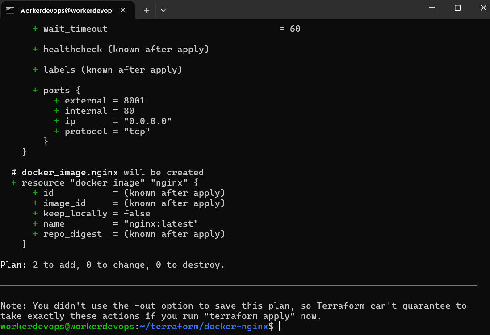
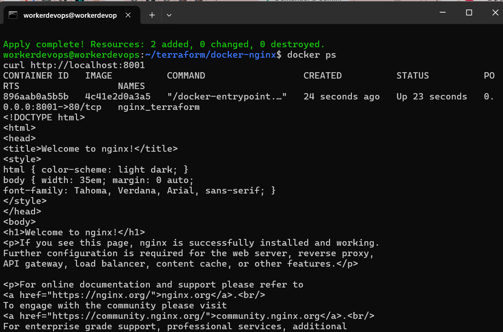
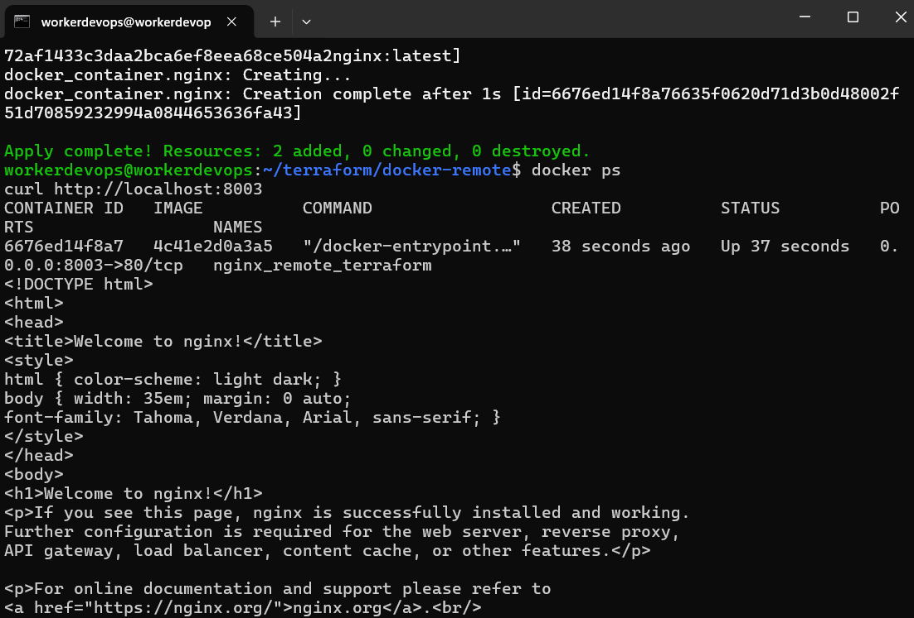

# TP6 – Infrastructure as Code avec Terraform (intégration Vagrant + Ansible)

> **Enseignant :** Wahid Hamdi
> **Auteur :** Nawres Zarrouki

Description d'une infrastructure **par du code** avec **Terraform** (HCL) : pilotage de Docker en local puis à distance via SSH, paramétrage par variables, puis enchaînement **Vagrant** (TP5), **Ansible** (TP4) et **Terraform** dans un même lab.

## Sommaire

1. [Principe de Terraform](#1-principe-de-terraform)
2. [Installation](#2-installation)
3. [Exemple simple : conteneur nginx avec Docker](#3-exemple-simple--conteneur-nginx-avec-docker)
4. [Variables](#4-variables)
5. [Docker distant via SSH](#5-docker-distant-via-ssh)
6. [TP d'intégration : Vagrant, Ansible et Terraform](#6-tp-dintégration--vagrant-ansible-et-terraform)
7. [Défi : reverse proxy nginx](#7-défi--reverse-proxy-nginx)
8. [Résumé des captures](#8-résumé-des-captures)

---

## 1. Principe de Terraform

Terraform décrit l'infrastructure de manière **déclarative** dans des fichiers `.tf`. Il compare l'état souhaité à l'état actuel, enregistré dans le fichier d'état (*state*), et calcule les actions nécessaires.

| Commande | Rôle |
|---|---|
| `terraform init` | Télécharge les providers dans `.terraform/` et crée `.terraform.lock.hcl` |
| `terraform fmt` / `validate` | Formate et valide le code |
| `terraform plan` | Affiche les actions prévues (`+` création, `~` modification, `-` suppression) |
| `terraform apply` | Crée ou modifie les ressources |
| `terraform destroy` | Supprime tout ce qui est dans l'état |

Les **providers** (plugins) pilotent les plateformes : ici `kreuzwerker/docker`. L'idempotence est visible quand un second `apply` répond `No changes`.

> `terraform.tfstate`, `.terraform/` et les `*.tfvars` contenant des secrets ne sont **pas** versionnés. `.terraform.lock.hcl` l'est.

---

## 2. Installation

```bash
sudo apt update && sudo apt install -y gnupg software-properties-common wget
wget -O- https://apt.releases.hashicorp.com/gpg | sudo gpg --dearmor -o /usr/share/keyrings/hashicorp-archive-keyring.gpg
echo "deb [arch=$(dpkg --print-architecture) signed-by=/usr/share/keyrings/hashicorp-archive-keyring.gpg] https://apt.releases.hashicorp.com $(lsb_release -cs) main" \
  | sudo tee /etc/apt/sources.list.d/hashicorp.list
sudo apt update
sudo apt install -y terraform
terraform version
```

Docker doit aussi être installé, avec l'utilisateur dans le groupe `docker` :

```bash
sudo apt install -y docker.io
sudo usermod -aG docker $USER      # puis se reconnecter
docker ps
```

---

## 3. Exemple simple : conteneur nginx avec Docker

Chaque projet Terraform vit dans son propre dossier. La configuration crée une image `nginx` et un conteneur `nginx_terraform` exposé sur le port **8001**.

Fichier `docker-remote/main.tf` :

```hcl
terraform {
  required_providers {
    docker = {
      source  = "kreuzwerker/docker"
      version = "~> 3.0"
    }
  }
}

provider "docker" {
  # Connexion à Docker sur la VM distante via SSH
  host = "ssh://workerdevops@192.168.201.128:22"
}

resource "docker_image" "nginx" {
  name         = "nginx:latest"
  keep_locally = false
}

resource "docker_container" "nginx" {
  image = docker_image.nginx.image_id
  name  = "nginx_remote_terraform"
  ports {
    internal = 80
    external = 8003
  }
}
```

Fichier `integration-cv/main.tf` :

```hcl
terraform {
  required_providers {
    docker = {
      source  = "kreuzwerker/docker"
      version = "~> 3.0"
    }
  }
}

provider "docker" {} # Utilise le Docker local de la VM

variable "external_port" {
  type = number
}

resource "docker_image" "cv" {
  name         = "cv-one-page:latest"
  keep_locally = true
  build {
    context = "/opt/cv"
  }
}

resource "docker_container" "cv" {
  image = docker_image.cv.image_id
  name  = "cv_container"
  ports {
    internal = 80
    external = var.external_port
  }
}
```

Fichier `main.tf` :

```hcl
terraform {
  required_providers {
    docker = {
      source  = "kreuzwerker/docker"
      version = "~> 3.0"
    }
  }
}

provider "docker" {}   # Vide = Docker local via le socket unix

resource "docker_image" "nginx" {
  name         = "nginx:latest"
  keep_locally = false
}

resource "docker_container" "nginx" {
  image = docker_image.nginx.image_id
  name  = "nginx_terraform"
  ports {
    internal = 80
    external = var.external_port
  }
}
```

Fichier `variables.tf` :

```hcl
variable "external_port" {
  description = "Port de l'hôte associé au port 80 du conteneur nginx"
  type        = number
  default     = 8001
}
```

Cycle de travail :

```bash
terraform init
terraform fmt
terraform validate
terraform plan
terraform apply
docker ps
curl http://localhost:8001
terraform state list
terraform show
```

### Plan



### Apply et vérification



Un second `terraform apply` répond `No changes` : la configuration est idempotente.

---

## 4. Variables

Le port externe devient un paramètre (`variable "external_port"`, défaut `8001`), utilisé dans `main.tf` avec `external = var.external_port`.

```bash
terraform apply -var external_port=8002
# ou
terraform apply -var-file=dev.tfvars
```

---

## 5. Docker distant via SSH

Le provider Docker peut joindre un démon distant par SSH :

```hcl
provider "docker" {
  host = "ssh://user@devopslab:22"
}
```

Prérequis : Docker actif sur la VM `devopslab`, utilisateur dans le groupe `docker`, authentification SSH **par clé** (`ssh user@devopslab docker ps` sans mot de passe, voir TP4) et résolution du nom (`/etc/hosts` ou adresse IP).



Nettoyage :

```bash
terraform destroy
```

---

## 6. TP d'intégration : Vagrant, Ansible et Terraform

```
VM Ubuntu 26.04
 └─ Vagrant ──► vm1 (Ubuntu 24.04)  ◄── Ansible : installe Docker + Terraform
             └► vm2 (Ubuntu 24.04)  ◄── Terraform : conteneur CV One Page
                 vm1:8001   vm2:8002
```

Étapes : 2 VM Ubuntu 24.04 (box `bento/ubuntu-24.04`) créées avec Vagrant, image Docker du CV One Page (HTML5 / CSS3, basée sur nginx) publiée sur Docker Hub, puis playbook Ansible qui installe Docker et Terraform et crée le conteneur : port externe **8001** sur la 1re VM, **8002** sur la 2e.

### Vagrantfile

Fichier `integration-cv/Vagrantfile` :

```ruby
ENV['VAGRANT_DEFAULT_PROVIDER'] = 'docker'

Vagrant.configure("2") do |config|
  config.ssh.insert_key = false

  # --- VM 1 (Port 8001) ---
  config.vm.define "vm1" do |vm1|
    vm1.vm.hostname = "vm1"
    vm1.vm.network "forwarded_port", guest: 8001, host: 8001
    vm1.vm.provider "docker" do |d|
      d.build_dir = "vagrant-base"
      d.has_ssh = true
      d.create_args = ["--privileged"]
    end
    vm1.vm.provision "ansible" do |ansible|
      ansible.playbook = "site.yml"
      ansible.extra_vars = { 
        ansible_python_interpreter: "/usr/bin/python3",
        port_cv: 8001
      }
    end
  end

  # --- VM 2 (Port 8002) ---
  config.vm.define "vm2" do |vm2|
    vm2.vm.hostname = "vm2"
    vm2.vm.network "forwarded_port", guest: 8002, host: 8002
    vm2.vm.provider "docker" do |d|
      d.build_dir = "vagrant-base"
      d.has_ssh = true
      d.create_args = ["--privileged"]
    end
    vm2.vm.provision "ansible" do |ansible|
      ansible.playbook = "site.yml"
      ansible.extra_vars = { 
        ansible_python_interpreter: "/usr/bin/python3",
        port_cv: 8002
      }
    end
  end
end
```

### Playbook Ansible

Fichier `integration-cv/roles/terraform_runner/tasks/main.yml` :

```yaml
---
- name: Créer le dossier d'application
  ansible.builtin.file:
    path: /opt/cv
    state: directory
    mode: '0755'

- name: Copier le CV et le Dockerfile
  ansible.builtin.copy:
    src: "{{ item }}"
    dest: /opt/cv/
  loop:
    - cv/index.html
    - cv/Dockerfile
    - main.tf

- name: Initialiser Terraform
  ansible.builtin.command:
    cmd: terraform init
    chdir: /opt/cv

- name: Appliquer Terraform avec le bon port
  ansible.builtin.command:
    cmd: terraform apply -auto-approve -var="external_port={{ hostvars[inventory_hostname]['port_cv'] }}"
    chdir: /opt/cv
```

Fichier `integration-cv/site.yml` :

```yaml
---
- name: Déployer le CV avec Terraform
  hosts: all
  become: true
  roles:
    - terraform_runner
```

### Image Docker du CV

Fichier `integration-cv/cv/Dockerfile` :

```dockerfile
FROM nginx:alpine
COPY index.html /usr/share/nginx/html/index.html
```

Fichier `integration-cv/vagrant-base/Dockerfile` :

```dockerfile
FROM ubuntu:22.04
ENV DEBIAN_FRONTEND=noninteractive

# 1. Installation des prérequis
RUN apt-get update && apt-get install -y openssh-server sudo python3 docker.io curl unzip python3-docker python3-requests gnupg software-properties-common

# 2. Installation de Terraform
RUN wget -O- https://apt.releases.hashicorp.com/gpg | gpg --dearmor -o /usr/share/keyrings/hashicorp-archive-keyring.gpg && \
    echo "deb [signed-by=/usr/share/keyrings/hashicorp-archive-keyring.gpg] https://apt.releases.hashicorp.com $(lsb_release -cs) main" | tee /etc/apt/sources.list.d/hashicorp.list && \
    apt-get update && apt-get install -y terraform

# 3. Configuration SSH
RUN mkdir /var/run/sshd
RUN sed -i 's/#PermitRootLogin prohibit-password/PermitRootLogin yes/' /etc/ssh/sshd_config
RUN useradd -m -s /bin/bash vagrant && echo 'vagrant:vagrant' | chpasswd
RUN echo 'vagrant ALL=(ALL) NOPASSWD:ALL' > /etc/sudoers.d/vagrant
RUN mkdir -p /home/vagrant/.ssh && \
    curl -sSLo /home/vagrant/.ssh/authorized_keys https://raw.githubusercontent.com/hashicorp/vagrant/main/keys/vagrant.pub && \
    chown -R vagrant:vagrant /home/vagrant/.ssh && chmod 700 /home/vagrant/.ssh && chmod 600 /home/vagrant/.ssh/authorized_keys

# 4. Script de démarrage (Docker + SSH)
RUN echo '#!/bin/bash\ndockerd --iptables=false --storage-driver=vfs > /tmp/dockerd.log 2>&1 &\n/usr/sbin/sshd -D' > /start.sh
RUN chmod +x /start.sh
CMD ["/start.sh"]
```

### Autres fichiers Terraform

Le CV One Page est servi par chacune des deux VM :


---

## 7. Défi : reverse proxy nginx

Un reverse proxy nginx sert de passerelle et de point d'entrée unique pour l'application CV One Page.

_(aucun fichier correspondant dans le dépôt)_


---

## 8. Résumé des captures

| Capture | Contenu |
|---|---|
| `terraform-plan.png` | Sortie de `terraform plan` (ressources à créer) |
| `terraform-apply.png` | `terraform apply` puis `docker ps` et `curl http://localhost:8001` |
| `terraform-remote.png` | Conteneur créé sur la VM `devopslab` via le provider SSH |
| `integration-cv.png` | CV One Page servi sur `vm1:8001` et `vm2:8002` |
| `reverse-proxy.png` | (Défi) CV servi par le reverse proxy nginx |
